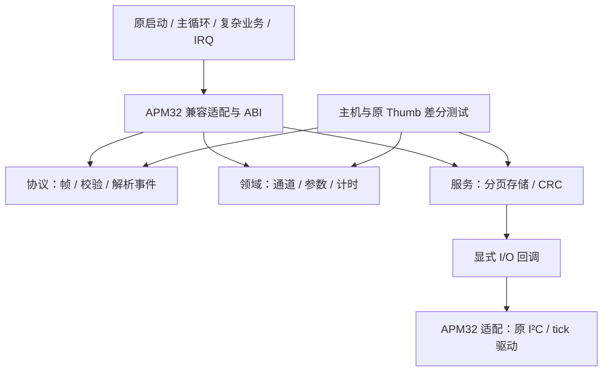

# 固件架构与迁移决策

查阅日期：2026-11-07。基线：`f3451ef`。这是在恢复工程之上建立日常开发层的渐进重构，保留原业务和 Flash 分区，不将反编译稿重命名后当作完整产品源码。

## 约束与选择

Arm 官方 [APM32F030C8 器件资料](https://www.keil.arm.com/devices/geehy-apm32f030c8/features/)列出 Cortex-M0+、64 KiB Flash、8 KiB SRAM；项目实际向量、寄存器及分区依据见 `recovery/MODULE_MAP.md`。现有程序使用裸机主循环和中断，当前没有必须引入 RTOS 的需求或实测收益。

[CMSIS-Driver 的操作模型](https://arm-software.github.io/CMSIS_6/latest/Driver/theoryOperation.html)明确区分应用、驱动实例、回调和外设访问，驱动不必依赖 RTOS。这里借鉴接口隔离原则，采用本项目所需的最小 C 接口；并未引入 CMSIS-Driver 实现或声称符合全部标准。原阻塞发送、超时与调度行为继续按证据保留，异步改造应作为单独行为变更。

比较后的选择：

| 路线 | 判断 |
|---|---|
| 继续直接编辑整份汇编或 CPU 模型 | 可复现，但规则、硬件和验证纠缠，不适合作为日常开发入口 |
| 一次性重写纯 C + 厂商 SDK/RTOS | 主循环仍有未命名字段、未知设备、动态 IRQ/DMA 和板级条件；当前证据不足以证明全量替换保留行为 |
| 纯 C 模块 + 小接口 + 原汇编兼容层 | 已采用。规则可独立开发测试，已验证模块接入整机，未迁移功能继续存在 |

这是结合项目证据的工程判断，并非官方指定的唯一架构。没有更换语言、引入堆分配、操作系统或未经核实的 SDK 依赖。

## 职责和依赖

- `domain` 只处理调用者拥有的数据；字段物理含义不明时保留中性偏移名。52 字节通道记录受静态断言保护。
- `protocol` 负责字节语义，返回事件或构建结果；不发送 UART，不访问 MMIO。
- `services/storage` 负责范围检查、128 字节分页、就绪轮询和错误策略，依赖 `ChargeStorage` 回调。协议格式与存储业务不依赖具体驱动名。
- `platform/apm32` 独占原地址和 ABI，调用旧驱动；公开模块没有绝对 SRAM、寄存器或 Flash 地址。
- 状态由调用者持有，无隐藏的可写全局状态。并发序列化由调用者/平台负责，`volatile` 不代表读改写原子性。
- `recovery/` 保持可独立重建的历史基准；生成兼容汇编只写 `firmware/build/`，不得反向生成或修改证据。

## 已落地的行为与归属

| 编号 | 原行为依据 | 新归属 | 原生接入 |
|---|---|---|---|
| PROTO-01 | `8EAC` parser，固定55/44与可变长度行为 | `protocol/serial.c` + 调用者 parser/buffer | 暂保留原 RX；新 API 已独立验证 |
| PROTO-02 | `8E84`块校验、`C7C4`发包、`964E`标识符响应 | `protocol/serial.c` | `C7C4`已接入；其他保留旧路径 |
| CONFIG-01 | `BCD8`23字节参数、阈值和更新标志 | `domain/config.c` | 已接入 |
| CHANNEL-01 | `C85C`位图和双位状态、`9E14`字段清理 | `domain/channel.c` | 已接入，两入口 |
| TIMER-01 | 主循环 delta、93槽递减规则 | `domain/timer.c` | 原主循环仍使用旧代码 |
| STORAGE-01 | `7498/74C4/74FC`读、就绪、分页 | `services/storage.c` + platform callbacks | 已接入，三入口 |
| UPDATE-01 | `2AC4/01FC`CRC递推与补零 | `services/crc16.c` | Boot保持原实现 |
| LEGACY-01 | 其余全镜像实现 | 恢复汇编兼容层 | 全部保留；没有成功空桩替代 |

新公开 API 对空指针、输出容量、缺失存储回调和短块提供显式拒绝；与原固件的等价声明限于已定义的有效输入域。parser 则保留原 8 位索引回绕和 mode 1 不派发的已知行为，调用者必须提供完整256字节缓冲；这不是一次协议加固。

解析事件返回前重置 index，与原 callback 内部能观察到的状态/重入时序不同，因此该 API 暂不用于原 RX 入口。原缓冲后32字节已有其他对象，不能把测试缓冲大小当作原分配大小。

I²C 适配纠正历史手工译文：`08005EA8(handle, 0xA0, NULL, 0, 50)` 是五参数零长度发送探测。历史 `application.c` 的四参数 `i2c_ready` 只留作恢复记录，新模块不使用该错误原型。

## 原生迁移机制与边界

`prepare_legacy.py` 将七处原函数入口的前16字节改成保留寄存器和原 SP 的 Thumb 尾跳。C 单独交叉编译并链接到原 App 的 FF 区 `0800D000–0800F7FF`；布局、入口范围和构建前 HEX 身份均校验。原源码无需手工同步第二份。

Flash 完整布局保持：Boot `0000–3FFF`、App `4000–F7FF`、metadata `F800–FBFF`、config `FC00–FFFF`。新 `.data/.bss` 被链接器禁止，防止旧启动未初始化新状态；扩展超过10 KiB也无法链接。原扩展区只有已确认FF，静态分支未指向其中；此前 scatter 源字段指向 `CF28`，其 zero-init 处理函数不读取该源。动态计算目标及自读逻辑仍受现有证据范围限制。

旧 Keil 调用者不一定只依赖标准 AAPCS。例如 `9D84` 在调用 `9E14`后立即使用 r3，新专用 shim必须保存它；`7498`的r1/r2也保留。其余r3栈槽被原函数复用，不能仅凭push/pop推断保留。原生测试运行真实上游通道初始化函数，覆盖这种跨调用关系。新 C 的指令、栈用量、字节写入粒度与原实现不同，电气时序和 IRQ 并发须台架验收。

输出 `charge.hex/bin` 是开发镜像，不是原始恢复镜像，也不是已验证的量产包。当前没有生成升级专用 `app.bin`：后续升级包必须包含新增 C 至实际末端、正确处理偶数字节长度，并实测原Boot的传输/提交流程。

## 后续全量迁移所需工作

当前完成的是可开发的模块层及七入口集成，**整个固件转为常规纯 C 工程尚未完成**。剩余项有明确归属：

1. 将 `B0DC/9694/C298/BE24` 的命令和通道业务改为显式应用状态，保留未知字段和外部契约，扩大现有差分场景。
2. 将 `A708` 主循环改为调度与事件协调，覆盖93计时槽、按键阻塞与串口队列；CPU模型继续做验证依据。
3. 按板级接线落实 UART/DMA/IRQ、GPIO、显示、脉宽、Flash、时基的真实平台实现，再替换原驱动。
4. 在台架验证启动、并发、栈、外部设备和完整升级后，才能取消兼容入口与固定RAM布局，并切换为普通 C startup/linker 工程。

这些功能当前仍由兼容汇编提供，未删除、未假定不存在，也未用占位实现冒充迁移完成。
